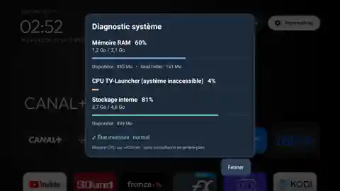

# 📺 TV-Launcher Min

**Un écran d'accueil Android TV / Google TV léger, personnalisable et pensé pour la télécommande.**  
*A lightweight, customizable launcher for Android TV & Google TV.*

**Première version stable : v1.0.0 · Android 8.0+**

[**⬇️ Télécharger l'APK v1.0.0 / Download APK**](https://github.com/vincent-deprato/tv-launcher-min/releases/latest/download/tv-launcher.apk) · [Toutes les versions / Releases](https://github.com/vincent-deprato/tv-launcher-min/releases)

> **Historique :** les versions 4.2.0 à 4.8.0 étaient des versions de développement et de validation. La version **1.0.0** inaugure la numérotation publique stable. Le nom de version repart à 1.0.0, mais le `versionCode` Android continue d'augmenter (19 après 18) afin de préserver les mises à jour et les paramètres.

## 🇫🇷 En bref

- **Accueil personnalisable** : six favoris, grille réorganisable et applications masquées.
- **Navigation à la télécommande** : horloge, Wi-Fi, sources TV et paramètres.
- **Diagnostic système** : RAM système et application (PSS), CPU, stockage, préparation HOME et pression mémoire, à la demande.
- **Mises à jour intégrées** : détection GitHub, téléchargement vérifié et confirmation Android.
- **Sans surveillance permanente** : les diagnostics ne tournent pas en arrière-plan.

### Aperçu du diagnostic

### Installer en trois étapes

1. Téléchargez `tv-launcher.apk` depuis la **Release officielle**.
2. Installez l'APK sur la télévision ou la box, puis lancez TV-Launcher Min.
3. Choisissez TV-Launcher Min comme accueil **si Android le propose**.

⚠️ **Important :** ne désactivez pas le launcher constructeur sans procédure de retour arrière. Sur certains appareils Sony et Xiaomi, la configuration nécessite ADB et peut affecter le Wi-Fi ou les touches de la télécommande.

[Installation détaillée](docs/INSTALLATION.md) · [Guide Xiaomi](docs/XIAOMI-BOX-S-2ND-GEN.md)

### Appareils testés

**Sony Bravia KD-55XF9005** (Android TV) et **Xiaomi TV Box S 2e génération** (Google TV 11, firmware 773). Tests réalisés sur ces appareils, sans généralisation à tous les firmwares.

| Scénario de mise à jour | Xiaomi TV Box S 2e génération | Sony Bravia KD-55XF9005 |
|---|---|---|
| **4.6 → 4.8** via le menu intégré | ✅ Validé | ✅ Validé |
| **4.8 → 1.0.0** : détection de version | ✅ Validé le 24 octobre 2026 | ⏳ À confirmer |
| **4.8 → 1.0.0** : téléchargement et installation | ✅ Validé le 24 octobre 2026 | ⏳ À confirmer |
| **4.8 → 1.0.0** : redémarrage et fonctionnement de HOME | ✅ Validé le 24 octobre 2026 | ⏳ À confirmer |
| **4.8 → 1.0.0** : conservation des favoris et paramètres | ✅ Validé le 24 octobre 2026 | ⏳ À confirmer |

Les favoris et l'ensemble des paramètres avaient également été conservés lors de la mise à jour **4.6 → 4.8** sur les deux appareils. Sur Sony, Android avait demandé d'autoriser l'application installatrice à installer des APK avant de poursuivre. La **migration 4.8 → 1.0.0 est désormais validée de bout en bout sur Xiaomi**, sans désinstallation ni perte de configuration.

### Un launcher plus léger que le projet d'origine

TV-Launcher Min est une version recentrée de [CleanYourTV](https://github.com/Gathin23/cleanyourtv), sans flux de recommandations, fond vidéo ni modules décoratifs superflus. Comparaison des **sources GitHub** avec la branche `main` de CleanYourTV consultée en octobre 2026 (pas nécessairement le commit historique de création du fork) :

| Indicateur | CleanYourTV | TV-Launcher Min v4.7 | Réduction |
|---|---:|---:|---:|
| Fichiers Java de l'application | 49 | 8 | **−83,7 %** |
| Lignes Java (avec blancs et commentaires) | 10 837 | 2 190 | **−79,8 %** |
| Fichiers dans `launcher/` | 177 | 46 | **−74,0 %** |
| Fichiers du dépôt avant préparation de release | 929 | 159 | **−82,9 %** |

Ces chiffres décrivent la taille du **code source et du dépôt**, et **non** une réduction mesurée de RAM, de CPU ou de taille APK. L'objectif reste un accueil sobre, rapide et contrôlable à la télécommande.

## 🇬🇧 English

TV-Launcher Min offers a **clean, remote-friendly home screen**, editable favourites, an organized app grid, on-demand RAM/CPU/storage diagnostics, and GitHub-based in-app updates.

**Quick start:** download the signed APK, install it on your Android TV device, then select it as Home if your device offers that option. **Do not disable the stock launcher without a device-specific recovery plan.**

[Installation guide](docs/INSTALLATION.md) · [Device compatibility and Xiaomi precautions](docs/XIAOMI-BOX-S-2ND-GEN.md)

**Update validation (24 October 2026):** the in-app upgrade **4.8 → 1.0.0** was successfully tested on the **Xiaomi TV Box S (2nd gen)**: version detection, download, installation, successful restart, working HOME, and preserved favourites and settings. The **Sony Bravia 4.8 → 1.0.0** upgrade is not yet verified; both devices previously passed 4.6 → 4.8 with settings preserved.

**v4.7:** internal app-list sorting and lifecycle callback optimizations, plus repository cleanup; no new interface features. Source comparison with CleanYourTV: 8 vs 49 Java files and 2,190 vs 10,837 Java source lines (−79.8%). This is not a measured RAM reduction.

## 📚 Documentation

| Guide | Contenu / Contents |
|---|---|
| [Installation](docs/INSTALLATION.md) | Installation, ADB, choix de HOME et restauration |
| [Mises à jour / Updates](docs/UPDATES.md) | Mise à jour intégrée, signature et autorisations |
| [Xiaomi TV Box S](docs/XIAOMI-BOX-S-2ND-GEN.md) | Procédure spécifique, risques et retour arrière |
| [Dépannage / Troubleshooting](docs/TROUBLESHOOTING.md) | Problèmes fréquents |
| [Historique / Changelog](docs/CHANGELOG.md) | Nouveautés et validations des versions |
| [Compilation / Build](docs/BUILD.md) | Compiler depuis les sources |
| [Spécification technique de l'updater](docs/UPDATER-V4.4.md) | Contrôles de sécurité et format des Releases |

## 🤝 Projet et crédits

Retours et suggestions : [GitHub Issues](https://github.com/vincent-deprato/tv-launcher-min/issues).

Projet communautaire basé sur [CleanYourTV](https://github.com/Gathin23/cleanyourtv) / TV-VibeHack. TV-Launcher Min n'est ni développé ni approuvé par Sony, Xiaomi ou Google. Les droits et licences du projet d'origine et des composants tiers restent applicables.
