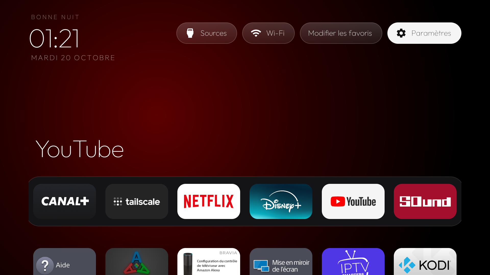

# TV-Launcher Min

[Français](#français) · [English](#english)

> A lightweight, remote-friendly Android TV launcher based on [CleanYourTV](https://github.com/Gathin23/cleanyourtv) / TV-VibeHack. This is a community fork, not an official Sony or Android product.



## Français

### Présentation

**TV-Launcher Min v4.2.0** est une personnalisation de CleanYourTV conçue pour une navigation épurée à la télécommande, notamment sur les téléviseurs Android TV disposant de peu de RAM. La version a été testée par le mainteneur sur une Sony Bravia Android TV ; sa compatibilité avec d'autres appareils reste à confirmer.

### Fonctionnalités

- Interface française avec horloge, date et raccourcis Sources, Wi-Fi et Paramètres.
- Six favoris : modifier leur ordre ou remplacer une application directement depuis la TV.
- Organiser, déplacer, masquer et réafficher les applications de la grille.
- Menus harmonisés pour une utilisation à la télécommande.
- Diagnostic ponctuel de la mémoire et du stockage, sans surveillance permanente.
- Appui long sur une application : informations système de l'application.
- Les choix d'organisation sont enregistrés localement.

**Non inclus :** sauvegarde/restauration JSON. Ces options ont été retirées dans la version 4.2.

### Installation

1. Ouvrir [Releases](https://github.com/vincent-deprato/tv-launcher-min/releases), puis choisir `v4.2.0` **lorsqu'elle sera publiée**.
2. Télécharger `tv-launcher.apk`, vérifier qu'il s'agit d'une version signée et installable, puis installer l'APK sur votre TV avec ADB (ou un installateur d'APK compatible).
3. Activer le débogage Android sur la TV, puis depuis un ordinateur :

```powershell
adb connect ADRESSE_IP_TV:5555
adb install -r tv-launcher.apk
```

4. Sélectionner TV-Launcher comme application d'accueil dans les paramètres Android, si l'option est disponible. Sur certains appareils, la commande ADB suivante peut être prise en charge (non garantie) :

```powershell
adb shell cmd package set-home-activity com.gathin.tvhome/.MainActivity
```

**Sécurité :** ne désactivez pas le launcher constructeur avant d'avoir testé celui-ci. Pour revenir en arrière, choisissez l'accueil précédent dans les paramètres Android ou désinstallez TV-Launcher via `adb uninstall com.gathin.tvhome` lorsque cela est possible.

### Compilation depuis les sources

Prérequis : JDK 17+, SDK Android (API 34), Build Tools 34.0.0 et ADB.

```powershell
cd launcher
$env:JAVA_HOME = "CHEMIN_VERS_VOTRE_JDK"
$env:ANDROID_HOME = "CHEMIN_VERS_VOTRE_SDK"
"sdk.dir=$($env:ANDROID_HOME.Replace('\','/'))" | Set-Content local.properties -Encoding ASCII
.\gradlew.bat assembleDebug --console=plain
```

La compilation de développement produit normalement `launcher/app/build/outputs/apk/debug/tv-launcher.apk`. **Attention : l'APK debug n'est pas recommandé pour la distribution publique** ; les Releases doivent contenir un APK signé avec une clé de publication conservée pour les mises à jour.

### Compatibilité et limites

- Source actuelle : `minSdk 26`, `targetSdk 29`, `compileSdk 34` ; la compatibilité sur des Android TV modernes n'est pas garantie.
- Certains contrôles de sources HDMI, informations réseau ou dialogues peuvent dépendre du fabricant.
- Le diagnostic mémoire Android est indicatif ; il ne remplace pas les mesures PSS détaillées.

### Crédits et licence

Fork dérivé de [CleanYourTV](https://github.com/Gathin23/cleanyourtv) par Gathin23. Conserver les notices de copyright et les licences du dépôt original, notamment la licence du code et celle de la police Outfit. Voir les fichiers de licence fournis par le dépôt d'origine. Les noms et logos des applications appartiennent à leurs propriétaires respectifs.

---

## English

### About

**TV-Launcher Min v4.2.0** is a streamlined Android TV home-screen customization based on CleanYourTV. It is designed for remote-control navigation and older devices with limited RAM. The maintainer has tested it on a Sony Bravia Android TV; other devices have not been validated.

### Features

- French-language home screen with clock, date, input, Wi-Fi and settings shortcuts.
- Six editable favorites: reorder or replace apps on your TV.
- Reorder, hide and restore apps in the main grid.
- Consistent, remote-friendly menus.
- On-demand RAM/storage information without a persistent monitoring service.
- Long-press on an app to open its Android app-information screen.
- Settings are saved locally.

**Not included:** JSON backup/restore; removed in v4.2.

### Installation

1. Open [Releases](https://github.com/vincent-deprato/tv-launcher-min/releases) and choose `v4.2.0` **once published**.
2. Download the properly signed `tv-launcher.apk` and install it via ADB or a compatible installer:

```powershell
adb connect TV_IP_ADDRESS:5555
adb install -r tv-launcher.apk
```

3. Select TV-Launcher as the default Home application in Android settings if supported. Some systems also accept:

```powershell
adb shell cmd package set-home-activity com.gathin.tvhome/.MainActivity
```

**Safety:** keep the stock launcher enabled until you've tested TV-Launcher. To roll back, switch to the previous Home app or use `adb uninstall com.gathin.tvhome`, where supported.

### Build from source

Requirements: JDK 17+, Android SDK Platform 34, Build Tools 34.0.0 and ADB.

```powershell
cd launcher
$env:JAVA_HOME = "PATH_TO_YOUR_JDK"
$env:ANDROID_HOME = "PATH_TO_YOUR_ANDROID_SDK"
"sdk.dir=$($env:ANDROID_HOME.Replace('\','/'))" | Set-Content local.properties -Encoding ASCII
.\gradlew.bat assembleDebug --console=plain
```

The debug build normally generates `launcher/app/build/outputs/apk/debug/tv-launcher.apk`. Do **not** treat debug signing as a proper long-term public release signature.

### Compatibility / known limits

- Current source settings: `minSdk 26`, `targetSdk 29`, `compileSdk 34`.
- OEM-dependent features may vary between Android TV manufacturers.
- RAM figures are informational and not equivalent to a detailed system-wide PSS analysis.

### Attribution

Based on [CleanYourTV](https://github.com/Gathin23/cleanyourtv) by Gathin23. Preserve the upstream copyright notices and license files, including third-party font licensing. App names/logos are trademarks of their respective owners.
